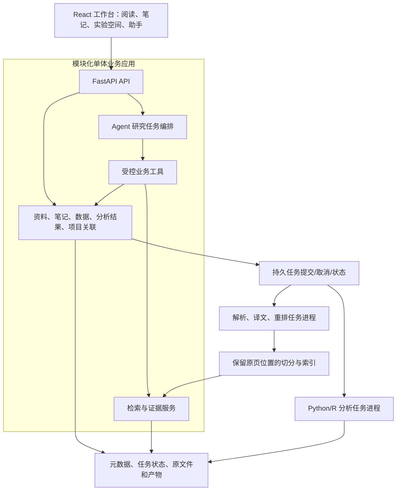

# research workspace：架构决定与实施顺序

2026-11-05 当前状态：线上前端 v0.62.1／后端 v0.62.0，可选择浏览器本机资料或独立服务器游客空间。
首次加载提示、前端独立发布、离线启动、服务器分析/绘图/PPT已交付。剩余顺序见 [今日计划](TODAY-PLAN-2026-11-05.md) 和 [近期计划](NEAR-TERM-PLAN.md)，
长期产品边界见 [产品路线](PRODUCT-ROADMAP.md)。下列版本条目保留历史，不代表当前完整状态。

v0.50.0 证据检索支持逐篇指定页码，例如“比较 A 的第35—38页与 B 的第12—15页”。指定页先限定范围，再执行有上限的检索，避免被排序更靠前的准备页挤出。仍在现有助手中使用，不自动准备全文；交互与召回未验收。见 [EVIDENCE-SEARCH.md](EVIDENCE-SEARCH.md)。

v0.49.0 在助手顶部的资料折叠区新增默认收起的“准备论文页面”：选择当前或已加入的论文、检查指定页、明确准备缺页并继续在原聊天提问。每次最多五页，原文准备不依赖模型；不自动发送消息或扫描全文。交互未验收。见 [ASSISTANT-PAGE-PREPARATION.md](ASSISTANT-PAGE-PREPARATION.md)。

v0.48.0 接通助手的已准备页面证据检索：沿用当前论文和本次明确加入的参考资料，返回短摘录、原页来源和实际搜索范围。第一片为有上限的关键词检索，没有向量检索、自动准备全文或新增功能面板；交互未验收。见 [EVIDENCE-SEARCH.md](EVIDENCE-SEARCH.md)。

v0.47.0 新增窄屏段落阅读：原文准备不依赖模型，支持查看匹配的已有译文、图表区域预览和返回原页。入口为阅读布局中的“段落阅读”。本轮是选页重排，不含扫描识别或完整语义版面重建；交互未验收。见 [FLOW-READING.md](FLOW-READING.md)。

v0.46.0 新增原文／双栏／译文覆盖切换，复用已保存结果；不明确的区域保留原文，长译文可展开。手机语义重排仍未实现，交互未验收。见 [OVERLAY-TRANSLATION.md](OVERLAY-TRANSLATION.md)。

v0.45.0 更新：新增独立的选页翻译调度/执行/本地解析进程，结果存入本机 SQLite；React 双栏消费原页绑定的译文。原 PDF 继续由现有阅读器管理。范围和未验收项见 [PAGE-TRANSLATION.md](PAGE-TRANSLATION.md)。

2026-11-03 用户确认前端采用 React，并明确 Agent 编排、RAG 文献问答与 Python/R 分析都会建设。本文固定能力边界和演进方向，不把尚未实施的组件写成当前事实。

同日最新决定：先与 tFUS 完全切割，第一阶段单机默认本地游客，资料存在运行本地后端的用户电脑，不要求注册登录；以后再加多账号。工作台不依赖 tFUS 成员目录或 W10-A 进度；主工程自己的身份目录和范围保持原状。

## 决策依据

默认假设不能直接成立：React 不自动解决状态混乱；引入 Agent 框架不等于任务可恢复；加载科研技能不等于安装了可运行工具；文献问答也不等于先部署向量数据库。

可验证的约束是：已有原文/批注/笔记/分析结果必须保留；一个视图状态与 DOM 子树需要明确管理者；模型输出不是实际计算结果；耗时解析/翻译/分析需要独立生命周期；一个人开发需要控制部署与重复状态维护成本。

据此确定：React 前端，FastAPI 模块化单体业务后端，独立任务进程，持久任务状态，统一可追溯资料，Agent 通过受控工具调用业务能力。先在应用内划清职责，再按实际部署需要抽取部件。不按功能清单同时增加多套应用、数据库或编排器。

## 当前与目标

v0.44 已交付 React 的本地游客/品牌头部与真实文献目录；其余原生控制器保留。当前源码和组件边界见 [REACT-GUEST.md](REACT-GUEST.md)；下表 v0.43 一栏保留迁移前起点，不代表整站已改为 React。

| 层 | v0.43 当前实现 | 已确定的目标 |
| --- | --- | --- |
| 前端 | 原生 JavaScript ES modules，PDF.js、富文本、图表等本地组件 | React + TypeScript + Vite；渐进迁移为可组合视图，现有 API 与资料继续使用 |
| 业务应用 | FastAPI，文献/笔记/数据/分析/图表/项目模块，共用 Store | 单一业务规则和授权入口，按钮与 Agent 共用，资料归属不交给编排框架 |
| Agent | 自定义工具调用循环、来源记录、明确共享、写入提案确认；后台线程仍在 Web 进程内 | 确定建设持久的研究任务编排：阶段、暂停/取消、恢复、预算、确认与实际成果记录；实现框架另行定型 |
| 文献问答 | 明确共享的资料、按页读取、材料搜索、来源引用 | 补建结构解析、可追溯切分、索引、受限检索、证据回答；按需求采用关键词/向量混合检索 |
| 分析 | 固定 Python/R 方法，已有独立分析进程及实际产物 | 扩展统计/数据处理/绘图能力，保留输入、参数、方法版本、环境和结果；用户自定义代码属于另行定义的隔离执行范围 |
| 数据与文件 | SQLite 元数据/关系/状态，本地原文件、截图、分析与导出产物 | 保持明确原始归属与版本；检索索引、译文、重排视图是可重建派生内容 |
| 部署 | 独立于 tFUS，本机单用户、回环入口 | 先单机默认游客，后续独立多账号/服务器部署；多人开放前补齐身份和逐资源授权；未来以接口接入 tFUS，不依赖其进度 |

## 目标组件关系

这是目标关系，不代表新任务系统、MinerU、RAG 或 React 已上线。Agent 的长期编排与 Web 的进程解耦安排在研究任务迭代，不将现有后台线程称为隔离 Agent 服务。

## 四条贯穿能力

1. **资料与来源**：文献原件、页码/位置、笔记、数据版本和实际结果由业务层管理。项目仅整理关联，加入项目不自动共享给助手或其他用户。
2. **RAG 文献问答**：原文 → 解析块/原页位置 → 有边界的切分与索引 → 按已授权资料检索 → 证据片段 → 回答及出处。结果回跳到原文件版本；失效索引要可重建。解析失败、未检索到或只有摘要时明确范围。
3. **研究任务编排**：用户目标 → 计划阶段 → 工具请求 → 需要时确认 → 任务状态 → 实际结果。文献检索、RAG、分析与保存都通过同一业务工具。K-Dense 提供经选择的操作知识和脚本；LangGraph/自定义实现是同一编排职责的实现选择，不同时维护两个任务事实来源。
4. **Python/R 分析**：已授权输入 + 明确方法/参数 → 独立任务 → 校验实际结果 → 保存产物和来源 → 界面/助手引用。排队和执行中不算成功，模型生成的数值不作为执行结果。新增方法逐项接入现有能力。

翻译按钮、保存笔记、运行已选分析等明确操作直接调用业务服务；助手调用同一能力。沉浸式翻译不需要先绕完整 Agent 规划循环或等待 RAG 系统全部建成。

## React 迁移切片

- 先确定 React 根、构建产物与现有 FastAPI 静态资源的交付方式。现有 web/ 已有 React 构建工程；这一条保留首轮迁移边界，后续按组件交付。
- 首个切片完成 React 外壳与文献选择/打开链，保持原文献 ID、URL、原页位置和保存 API；同时抽出旧入口初始化/销毁边界，避免新旧控制器同时监听或修改同一节点。
- PDF.js、富文本和图表等通过明确容器及生命周期适配。阅读位置、选区、编辑器光标与草稿不能因普通布局更新而被重新挂载清空。
- 然后迁移阅读/笔记/助手交互，并在新结构中交付优先级最高的沉浸式翻译；保留原文阅读可用。数据分析视图随后接入同一套任务和结果 API。
- 每个切片可单独交付和回退，不等待全站一次性重写，也不让两套业务状态长期并存。React 替换界面组织，不重建后端数据模型或为了迁移重新导入资料。

React 支持只接管页面的一部分，但 createRoot 会接管容器内部 DOM，需要显式清理外部订阅/组件。依据：[React 渐进接入](https://react.dev/reference/react-dom/client/createRoot)、[React 构建工具说明](https://react.dev/learn/build-a-react-app-from-scratch)。

## 迭代顺序与当前动作

### 多人服务器目标

第一阶段先单机默认游客工作区，不要求认证账号，复用本机 SQLite/文件持久保存正式资料，浏览器缓存作为辅助。游客只表示未认证的本机单人上下文，不是已验证身份，不提供多账号隔离；不为它增加假令牌或密码体系。

2026-11-04 的后续决定已扩展这一起点：浏览器本机模式用 IndexedDB 保存正式资料，服务器模式提供隔离游客空间。
二者明确选择、不隐式迁移；本机模式已有明确文字问答与选区翻译，整篇远程任务和数据导入/分析/PPT尚未接入。注册账号与共享空间仍是后续工作。

后续多账号版由独立认证模块验证身份、绑定稳定内部用户并执行逐资源授权。游客资料经明确选择迁移，保留文献/笔记/结果 ID，不自动归给首位登录者。将来对接 tFUS 再增加外部认证和账号映射，不按邮箱/同名自动合并。首轮本地阅读与翻译不等待账号系统。

现有服务器已开放隔离游客空间；可信账号与共享协作开放前仍须完成 U1 的身份和逐资源授权，
覆盖文件、RAG、助手上下文和后台任务，不能只做登录界面。近期顺序见 [近期任务计划](NEAR-TERM-PLAN.md)。
此处固定产品目标，不提前增加未经验证的共享空间 schema。

当前已交付 React 部分视图、本地源解析/翻译和已准备页关键词证据工具；真实论文翻译质量、
整站 React 与完整 RAG 仍未完成。OMP 当前选择 `deepseek-codex`：DeepSeek official 默认实现后端，
Codex 默认实现前端，并负责架构、工程拆解、协调与验收。额度回退按全局策略执行。

版本化前端发布已启用；随后交付一篇真实论文的沉浸式阅读，再接通本机资料的明确远程调用，
推进跨文献问答和真实实验表分析。React 迁移服务于这些流程，不作为必须先完成的整站重写。
检索、研究任务编排和 Python/R 扩展已确认建设；具体实现与新增方法按真实任务确定。

### 前端独立发布

保持一个业务后端和现有任务执行权。前端发布包按后端源码与稳定设备存储组件校验兼容性，
入口选择使用原子指针，组件通过带版本路径加载；旧版本保留，旧页面不刷新、不混用新组件。
切换界面不触发业务 lifespan、数据库迁移或任务恢复。后端自身更新仍有维护窗口，
不能直接用两个完整 Web/任务进程共用资料库来宣称无感切换。启用步骤见 [更新边界](UPDATE-POLICY.md)。
