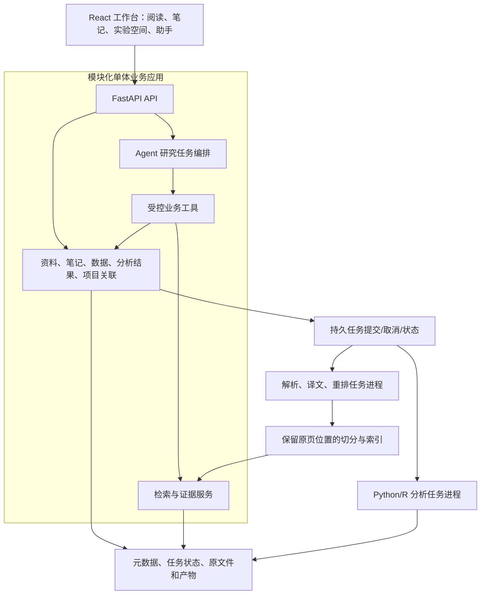

# research workspace：架构决定与实施顺序

2026-11-03 用户确认前端采用 React，并明确 Agent 编排、RAG 文献问答与 Python/R 分析都会建设。本文固定能力边界和演进方向，不把尚未实施的组件写成当前事实。

## 决策依据

默认假设不能直接成立：React 不自动解决状态混乱；引入 Agent 框架不等于任务可恢复；加载科研技能不等于安装了可运行工具；文献问答也不等于先部署向量数据库。

可验证的约束是：已有原文/批注/笔记/分析结果必须保留；一个视图状态与 DOM 子树需要明确管理者；模型输出不是实际计算结果；耗时解析/翻译/分析需要独立生命周期；一个人开发需要控制部署与重复状态维护成本。

据此确定：React 前端，FastAPI 模块化单体业务后端，独立任务进程，持久任务状态，统一可追溯资料，Agent 通过受控工具调用业务能力。先在应用内划清职责，再按实际部署需要抽取部件。不按功能清单同时增加多套应用、数据库或编排器。

## 当前与目标

| 层 | v0.43 当前实现 | 已确定的目标 |
| --- | --- | --- |
| 前端 | 原生 JavaScript ES modules，PDF.js、富文本、图表等本地组件 | React + TypeScript + Vite；渐进迁移为可组合视图，现有 API 与资料继续使用 |
| 业务应用 | FastAPI，文献/笔记/数据/分析/图表/项目模块，共用 Store | 单一业务规则和授权入口，按钮与 Agent 共用，资料归属不交给编排框架 |
| Agent | 自定义工具调用循环、来源记录、明确共享、写入提案确认；后台线程仍在 Web 进程内 | 确定建设持久的研究任务编排：阶段、暂停/取消、恢复、预算、确认与实际成果记录；实现框架另行定型 |
| 文献问答 | 明确共享的资料、按页读取、材料搜索、来源引用 | 补建结构解析、可追溯切分、索引、受限检索、证据回答；按需求采用关键词/向量混合检索 |
| 分析 | 固定 Python/R 方法，已有独立分析进程及实际产物 | 扩展统计/数据处理/绘图能力，保留输入、参数、方法版本、环境和结果；用户自定义代码属于另行定义的隔离执行范围 |
| 数据与文件 | SQLite 元数据/关系/状态，本地原文件、截图、分析与导出产物 | 保持明确原始归属与版本；检索索引、译文、重排视图是可重建派生内容 |
| 部署 | 独立于 tFUS，本机单用户、回环入口 | 仍是可独立部署的研究工作台；多人开放前补齐身份和逐资源授权，不放开 tFUS 边界 |

## 目标组件关系

这是目标关系，不代表新任务系统、MinerU、RAG 或 React 已上线。Agent 的长期编排与 Web 的进程解耦安排在研究任务迭代，不将现有后台线程称为隔离 Agent 服务。

## 四条贯穿能力

1. **资料与来源**：文献原件、页码/位置、笔记、数据版本和实际结果由业务层管理。项目仅整理关联，加入项目不自动共享给助手或其他用户。
2. **RAG 文献问答**：原文 → 解析块/原页位置 → 有边界的切分与索引 → 按已授权资料检索 → 证据片段 → 回答及出处。结果回跳到原文件版本；失效索引要可重建。解析失败、未检索到或只有摘要时明确范围。
3. **研究任务编排**：用户目标 → 计划阶段 → 工具请求 → 需要时确认 → 任务状态 → 实际结果。文献检索、RAG、分析与保存都通过同一业务工具。K-Dense 提供经选择的操作知识和脚本；LangGraph/自定义实现是同一编排职责的实现选择，不同时维护两个任务事实来源。
4. **Python/R 分析**：已授权输入 + 明确方法/参数 → 独立任务 → 校验实际结果 → 保存产物和来源 → 界面/助手引用。排队和执行中不算成功，模型生成的数值不作为执行结果。新增方法逐项接入现有能力。

翻译按钮、保存笔记、运行已选分析等明确操作直接调用业务服务；助手调用同一能力。沉浸式翻译不需要先绕完整 Agent 规划循环或等待 RAG 系统全部建成。

## React 迁移切片

- 先确定 React 根、构建产物与现有 FastAPI 静态资源的交付方式。当前没有主前端 React 构建工程，本次不安装依赖或替换线上页面。
- 首个切片完成 React 外壳与文献选择/打开链，保持原文献 ID、URL、原页位置和保存 API；同时抽出旧入口初始化/销毁边界，避免新旧控制器同时监听或修改同一节点。
- PDF.js、富文本和图表等通过明确容器及生命周期适配。阅读位置、选区、编辑器光标与草稿不能因普通布局更新而被重新挂载清空。
- 然后迁移阅读/笔记/助手交互，并在新结构中交付优先级最高的沉浸式翻译；保留原文阅读可用。数据分析视图随后接入同一套任务和结果 API。
- 每个切片可单独交付和回退，不等待全站一次性重写，也不让两套业务状态长期并存。React 替换界面组织，不重建后端数据模型或为了迁移重新导入资料。

React 支持只接管页面的一部分，但 createRoot 会接管容器内部 DOM，需要显式清理外部订阅/组件。依据：[React 渐进接入](https://react.dev/reference/react-dom/client/createRoot)、[React 构建工具说明](https://react.dev/learn/build-a-react-app-from-scratch)。

## 迭代顺序与当前动作

当前只更新架构决定和工程约束；线上保持 v0.43，未进行 React 依赖安装、构建、功能迁移或运行测试。执行切片前由 Codex 定义接口、文件职责和交付标准，实际 Kimi 负责前端、官方 DeepSeek 负责指定后端逻辑。

下一轮先落 React 首个可用切片并服务于沉浸式翻译，之后推进检索/RAG 文献问答、完整研究任务编排和 Python/R 能力扩展。各能力已确认建设；具体库、版本、部署方式与新增统计方法仍按真实任务确定。详见 [总任务表](TASK-PLAN.md)。
