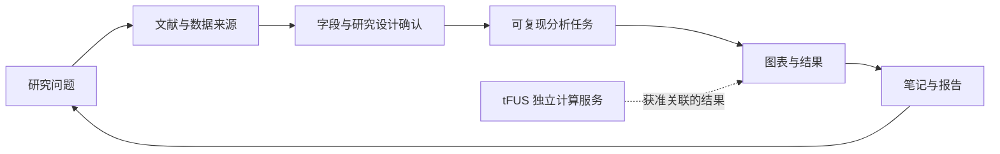

# 研究工作台：产品方向与近期迭代

2026-10-31。这是当前产品方向和建议优先级；本轮 v0.12 推进可信 SPSS 数据入口与验证。
后续迭代按真实任务验收推进，不把下表理解为已实现功能或固定工期。

## 长期画像

面向独立研究者和小型研究团队，让一项研究的材料、分析过程和结论留在同一条
可追溯链上：知道资料从哪里来、数据如何处理、结果怎样得到、哪些判断经过复核。

上图是目标工作流，尚未全部实现。最终组织单位应围绕研究项目逐步验证：一个研究
问题可以关联多篇论文、多份数据和多次分析。研究也可以从数据开始，不应长期要求
用户先上传一篇 PDF 才能分析。先验证实际流程，再决定项目对象和数据库迁移。

| 产品能力 | 长期要解决的问题 |
| --- | --- |
| 材料与证据 | 收集论文、图片、数据引用和研究笔记，判断能回到实际来源 |
| 数据工作区 | 保存原始文件、字段含义、标签、单位、缺失规则和数据版本，确认后才转换 |
| 分析与结果 | 使用成熟 Python/R 部件完成明确方法，保留代码、参数、环境、日志和输出 |
| Agent 协作 | 理解用户明确共享的上下文，提出方案、调用已验证工具、确认后执行、引用真实结果 |
| 项目与协作 | 组织研究记录、个人草稿和可共享成果；在认证与授权完成后支持团队使用 |

tFUS 是专业计算能力来源，研究工作台通过明确的结果契约关联它；保持独立进程、
执行队列和数据边界。身份来源沿用已确定的 tFUS 本地成员目录，不另建平行账号体系。
主工程 W10-A 基础源码已验收但未部署，全入口授权和工作台接入尚未完成。

## 现在实际做到哪里

已实现 PDF 阅读与上传、出处笔记/格式编辑、图片标注、CSV/TSV 数据预览、固定
Python/base R 描述统计、只读 Notebook、交互图表、独立样本 Student/Welch t 检验、
保存与导出，以及有明确上下文和逐项确认的 Agent。软件验收使用合成材料。

已支持 .sav/.zsav 导入：保留原文件和字段字典，明确核对后创建可分析的表，并记录转换来源。
当前仍是本机单人、以论文为关联入口的应用。尚无任意用户脚本运行、
登录/多人授权、研究项目首页或自动在线数据库下载。支持的统计方法以已安装能力
清单为准，不能称为覆盖全部 SPSS。jmv 在本机隔离验证中异常退出，首个 t 检验
直接复用它所调用的 R stats::t.test，详见 STATISTICAL-TESTS.md。

## 近期按三个可验收目标推进

| 顺序 | 本轮产物 | 完成标准 |
| --- | --- | --- |
| 已完成：主题与 Git | 蓝白配色和圆润控件贯穿可切换主题；按反馈移除口袋弧线与品牌图标，保留品牌文字；建立独立本地源码仓库 | 桌面/手机和中英文可用；默认主题、研究原文及数据保持完整；源码与文档可回退 |
| 本轮：可信数据入口 | 复用独立 pyreadstat/ReadStat 部件，增加 SPSS .sav/.zsav 导入和字段核对 | 原文件不改写；变量标签、值标签、系统/用户缺失语义保留；确认后生成分析表并保留转换记录；合成数据验证通过后交付 |
| 下一轮：真实分析闭环 | 选一份真实且适合使用的实验表和明确问题，补齐实际需要的方法 | 按实际设计选择独立/配对等方法，逐项做数值对照；Agent 提案→确认→分析→图表/结果→来源笔记与导出走通 |
| 随后一轮：研究项目入口 | 用上述实际流程验证论文、数据和结果的组织关系 | 能从数据或研究问题开始工作，容纳多篇文献和多次分析；历史资料有明确迁移方案后再改变模型 |

配对 t 检验可作为下一种方法候选；相关、方差分析、回归按真实任务排序。重复测量、
非参数方法和高级模型需要各自明确适用范围、参数与验证数据，不一次性承诺全部。
真实任务未选定前，先完成组件与合成数据验证，不假定配对、组别或显著性目标。

## 中期顺序与工程边界

1. 核心研究流程验证后，完善结果复核、跨文献比较和引用可靠的研究记录/报告导出。
2. 在明确需求下加入在线文献/数据库资料发现。默认保存引用与版本，按需下载；显示
   大小、存储位置和配额，避免自动镜像整库。坚果云等先作为文件/备份候选，活跃
   SQLite 仍由单一服务写入，不通过同步盘做实时多人数据库。
3. 自定义 Python/R 代码在明确任务后进入独立、受控、可停止的执行环境，保存环境
   与产物。它与 tFUS 的受控 Agent 执行面保持分离。
4. 先验证获准导出的 tFUS 结果关联，再在主工程发布可靠身份契约后接入工作台授权。
   多人开放前覆盖读取、搜索、写入、文件、导出、Agent、任务和撤权；历史资料归属
   显式确认。最后再扩大团队共享范围。

持续复用可独立调用的开源部件，保留上游来源、版本和许可。出现第二个真实消费者
并验证共同语义后，再提取共享包；当前不为未确认的项目/协作模型预留业务钩子。

维护方式保持轻量：本页解释产品与顺序，ROADMAP.md 记录交付，API/方法文档记录
已经存在的契约。一次迭代选一个可演示闭环，不同时维护多套未验证的详细 PRD。
