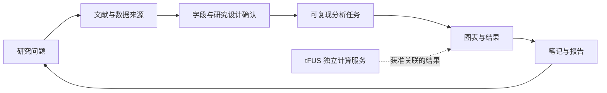

# 研究工作台：产品方向与近期迭代

2026-11-03 更新。最新版本与各项验证范围见 [README.md](README.md) 及对应功能文档。侧栏富文本与内联截图、原文选择去向、可撤回的助手草稿、左右边缘缩放、有界概述和紧凑来源展示已交付，见 [阅读体验](READING-EXPERIENCE.md) 与 [阅读体验记录](EXPERIENCE-PLAN.md)。此前已交付批注 PDF 导出、阅读位置恢复、配对 t 检验、相关分析、跨论文助手表格和在线数据元数据引用。连续任务仍逐项确认，见 [AGENT-TASKS.md](AGENT-TASKS.md)。
后续迭代按真实任务验收推进，不把下表理解为已实现功能或固定工期。

v0.33 补齐原位批注操作、仅针对文字批注的会话撤销/重做、目录与缩略图导航、首末页和阅读视图控制，见 [交付与验收](READER-COMPLETION.md)。截图中的图形批注、改原文及 PDF 页面处理仍按完整保存/出处/导出路径分项实施，不用图标数量表示已完成。

v0.32 另完成文字层和选区修复、嵌入位图右键复制及 PDF 原生引用跳转，见 [集成说明](PDF-READER-INTEGRATION.md)。用户提供的 pdf-manage 现成功能见 [参考清单](READER-FEATURE-REFERENCE.md)，区分上游已有与本工作台已接入。

## 已确认的产品定位：独立使用，按需组织

2026-11-03 用户确认：项目用于把相关论文、实验数据和结果组织在一起，方便查找；
它是可选的整理功能，不是阅读或分析的必经入口。

- 阅读：从文献库直接打开论文，完成阅读、批注、笔记和助手交流，无需创建项目。
- 数据分析：围绕选中的数据查看、整理、计算和绘图；产品目标是可直接开始分析，
  无需先上传论文或手动建立项目。
- 项目：需要按课题整理时再建立，关联已有论文、数据、结果和笔记；后续方案优先
  复用已有资料并保留出处，避免为了分类复制原文件或自动改变既有资料归属。

阅读与分析分别提供适合当前任务的工具；项目提供资料间的组织关系。R、Python 是
执行方式，CSV、SPSS 文件是输入格式，不作为必须先选择的主工作区。

v0.38 已实现独立入口和“我的数据”：阅读与数据侧栏按任务显示，项目按需展开。
现有数据和结果仍保留真实归属；跨归属整理既有数据/结果到项目的交互尚未实现。
v0.39 增加当前助手对话中的跨项目论文/数据引用，读取保留原始出处，不改变项目归属。
跨归属计算与任意脚本执行仍需另行定义结果位置和执行环境。
见 [入口说明](WORKSPACE-ENTRIES.md) 与 [助手引用](AGENT-REFERENCES.md)。本轮按要求未运行测试。

## 长期画像

面向独立研究者和小型研究团队，让一项研究的材料、分析过程和结论留在同一条
可追溯链上：知道资料从哪里来、数据如何处理、结果怎样得到、哪些判断经过复核。

上图是一项完整研究的目标工作流，尚未全部实现；用户也可以只阅读或只分析。
项目按需关联多篇论文、多份数据和多次分析，不要求先有项目才能使用工具。
先验证独立使用与后续整理的实际流程，再决定现有研究对象如何适配及是否需要迁移。

| 产品能力 | 长期要解决的问题 |
| --- | --- |
| 材料与证据 | 收集论文、图片、数据引用和研究笔记，判断能回到实际来源 |
| 数据工作区 | 保存原始文件、字段含义、标签、单位、缺失规则和数据版本，确认后才转换 |
| 分析与结果 | 使用成熟 Python/R 部件完成明确方法，保留代码、参数、环境、日志和输出 |
| Agent 协作 | 理解用户明确共享的上下文，提出方案、调用已验证工具、确认后执行、引用真实结果 |
| 项目与协作 | 组织研究记录、个人草稿和可共享成果；在认证与授权完成后支持团队使用 |

tFUS 是专业计算能力来源，研究工作台通过明确的结果契约关联它；保持独立进程、
执行队列和数据边界。身份来源沿用已确定的 tFUS 本地成员目录，不另建平行账号体系。
主工程 W10-A 基础源码已验收但未部署，全入口授权和工作台接入尚未完成。

## 现在实际做到哪里

已实现 PDF 阅读与上传、出处笔记/格式编辑、图片标注、CSV/TSV 数据预览、固定
Python/base R 描述统计、只读 Notebook、交互图表、独立样本 Student/Welch t 检验、
Pearson/Spearman 相关分析、保存与导出，以及有明确上下文和逐项确认的 Agent。
跨论文阅读/表格与在线元数据引用也已交付；软件验收使用合成材料，不替代研究结论复核。

已支持 .sav/.zsav 导入：保留原文件和字段字典，明确核对后创建可分析的表，并记录转换来源。
当前是本机单人应用，支持独立研究及论文两种入口。尚无任意用户脚本运行、
登录/多人授权、共享空间或自动在线数据库下载。支持的统计方法以已安装能力
清单为准，不能称为覆盖全部 SPSS。jmv 在本机隔离验证中异常退出，首个 t 检验
直接复用它所调用的 R stats::t.test，详见 STATISTICAL-TESTS.md。

## 近期验收与下一步

| 顺序 | 本轮产物 | 完成标准 |
| --- | --- | --- |
| 下一项：实际阅读成果链 | 从已上传论文和一个明确问题出发，形成有出处的文献笔记 | 关键判断有实际页码；文字/截图进入同一笔记；助手回答能核对来源；保存重开与导出可用；未读与不确定处明确标注 |
| 已完成：主题与 Git | 蓝白配色和圆润控件贯穿可切换主题；按反馈移除口袋弧线与品牌图标，保留品牌文字；建立独立本地源码仓库 | 桌面/手机和中英文可用；默认主题、研究原文及数据保持完整；源码与文档可回退 |
| 已完成：可信数据入口 | 复用独立 pyreadstat/ReadStat 部件，增加 SPSS .sav/.zsav 导入和字段核对 | 原文件不改写；变量标签、值标签、系统/用户缺失语义保留；确认后生成分析表并保留转换记录；合成数据验证通过后交付 |
| 待用户材料：真实实验分析闭环 | 选一份真实且适合使用的实验表和明确问题，补齐实际需要的方法 | 按实际设计选择独立/配对等方法，逐项做数值对照；Agent 提案→确认→分析→图表/结果→来源笔记与导出走通 |
| 已完成：研究入口与资料查找 | v0.17 数据起步研究与 v0.18 统一搜索 | 可关联真实论文、保存来源笔记和结果；原资料保留，搜索可回到实际来源 |

配对 t 检验和 Pearson/Spearman 相关分析已交付，见 [配对检验](PAIRED-T-TEST.md) 与 [相关分析](CORRELATION.md)；方差分析、回归仍按明确任务排序。重复测量、
非参数方法和高级模型需要各自明确适用范围、参数与验证数据，不一次性承诺全部。
真实任务未选定前，先完成组件与合成数据验证，不假定配对、组别或显著性目标。
实际阅读用于产出可用笔记并发现下一处操作问题；材料与问题未选定时，仍可按已明确的
开发需求使用合成资料推进，不把提交真实材料当成继续开发的硬性前置条件。

## 中期顺序与工程边界

1. 核心研究流程验证后，完善结果复核、跨文献比较和引用可靠的研究记录/报告导出。
2. 在明确需求下加入在线文献/数据库资料发现。默认保存引用与版本，按需下载；显示
   大小、存储位置和配额，避免自动镜像整库。坚果云等先作为文件/备份候选，活跃
   SQLite 仍由单一服务写入，不通过同步盘做实时多人数据库。
3. 自定义 Python/R 代码在明确任务后进入独立、受控、可停止的执行环境，保存环境
   与产物。它与 tFUS 的受控 Agent 执行面保持分离。
4. 先验证获准导出的 tFUS 结果关联，再在主工程发布可靠身份契约后接入工作台授权。
   多人开放前覆盖读取、搜索、写入、文件、导出、Agent、任务和撤权；历史资料归属
   显式确认。最后再扩大团队共享范围。

持续复用可独立调用的开源部件，保留上游来源、版本和许可。出现第二个真实消费者
并验证共同语义后，再提取共享包；当前不为未确认的项目/协作模型预留业务钩子。

维护方式保持轻量：本页解释产品与顺序，ROADMAP.md 记录交付，API/方法文档记录
已经存在的契约。一次迭代选一个可演示闭环，不同时维护多套未验证的详细 PRD。

## 已交付交互切片：以任务组织工作区

阅读时围绕原文和来源笔记；分析时围绕当前数据、设置、结果及关联图表，数据可以
归属于研究或论文，不要求依附论文。后续交互遵循上方已确认的独立入口与可选项目定位。
通过一个入口导入数据，格式路由留在内部；字段核对、分析确认和助手授权保持明确。
该历史切片仅组合当时已有能力；后续 v0.17 已增加轻量研究入口，见下文。
产品流程、参考来源与可验证边界见 [WORKSPACE-WORKFLOW.md](WORKSPACE-WORKFLOW.md)。
下一步用一条真实研究任务检验入口是否容易找到、来源是否清楚、笔记是否易于回溯，
再决定后续扩展，不据页面重排推断易用性已经提升。

## 首轮真实材料验证已完成

已用现有论文第8页表2的五种算法报告耗时，跑通实际模型→分析提案→界面确认→
实际Python计算→结果读取→Plotly预览/确认→来源笔记确认→离线导出。
这是已发表汇总值验证，未获得原始实验样本；不能据此做显著性推断。
工作区交互切片也已交付。下一轮仍以真实实验表和具体问题决定新增方法，
不把这次验证误写成原论文完整复现。详见[首轮记录](REAL-DATA-PILOT.md)。

## v0.14 当前进展与材料缺口

分类组别与观测值的图表表达已补齐，公开实验数据的实际R、Agent、图表、来源
笔记与离线导出已验收。用户自己的数据路径、行含义和研究问题仍未确定，不能
把公开样例的设计假设或方法直接套用。继续以实际任务决定后续方法和数据入口。
本轮使用与边界见 [GROUPED-OBSERVATIONS.md](GROUPED-OBSERVATIONS.md)。

## v0.15 数据准备切片

上一轮公开数据需外部脚本筛出剂量子集，本轮把这一步放进现有数据工作区：
一列一个原始值，预览后确认生成可追溯分析表，原表不变。Agent同样通过具体
提案与确认使用；新表重新明确共享。没有引入项目/共享模型、查询语言或新统计方法。
详见[筛选说明](DATASET-SELECTION.md)。后续扩展仍由明确研究问题排序。

## v0.16 研究记录导出切片

上一轮完整验收需外部脚本组合阅读、分析和图表导出；本轮在现有数据工作区加入
统一入口，先核对范围，再下载可离线查看的研究记录。复用既有导出器与来源链，
不重算结果、不新增项目/协作对象。普通Agent可准备相同范围，文件仍由用户下载。
详见[研究记录说明](RESEARCH-RECORD.md)。后续仍由具体研究问题决定新增分析方法。

## v0.17 从研究问题与数据开始

新增轻量研究归属，取消分析必须先有论文的前置条件。名称、问题、数据、分析、
图表和来源笔记在同一任务中组织，论文可稍后关联；沿用单一数据入口和明确确认。
本轮不增加共享空间、账号或新统计方法。下一步由用户自己的研究问题、行含义和
数据决定方法扩展；不能把公开演练的假设当作用户的实验设计。
详见[从数据开始研究](DATA-FIRST-STUDY.md)。

## v0.18 查找既有研究材料

统一搜索补齐研究名称、问题与当前来源笔记的查找路径，继续使用一个侧栏入口。
本轮没有增加统计方法、联网下载或共享权限。下一项实际分析任务仍需要用户给出
数据路径、每行含义和具体问题；公开软件演练不能替代这些输入。

## v0.19 配对分析切片

按公开且有明确对象标识的 sleep 样例验证同一对象两列测量，复用固定 R stats、
原分析工作进程、逐项确认、散点图、来源笔记和统一导出。仅支持宽表一行一对，
不据此推断用户自己的实验设计。下一种方法仍由具体任务和数据决定。

## v0.20 让现有研究流程更清楚

将核心结果、当前数据和助手草稿入口放在同一任务路径上，低频技术信息可展开。
共享、发送与业务写入仍分别确认。当前迭代只调整已验证能力的呈现；后续以具体
研究任务观察理解和操作问题，再决定新增能力。见[说明](RESULT-WORKFLOW.md)。

## v0.21 基础操作验收补齐

此前的分析链路验收没有充分覆盖阅读与资料管理。先完成“选择→草稿可见→保存→
找到摘录→回到原文”和“管理→删除→恢复→明确彻底删除”的基础闭环。以Zotero
已公开流程核对遗漏状态，直接复用已有PDF.js文字层，不宣称完成所有批注能力。
本轮结束后先用实际阅读任务复核基础功能，再排新的分析扩展。

## v0.22 把阅读批注接入研究上下文

补齐选择文字后的持久高亮、下划线和标色，让保存的批注能明确加入助手，
保留原文、说明、页码和回源链接。与普通笔记共用生命周期，不另开批注数据孤岛；
加入、发送与业务写入保持分开的用户动作。见[说明](TEXT-ANNOTATIONS.md)。

## v0.23 读后整理

围绕当前论文增加全文文字查找、颜色/类型/文字筛选与批量引用；用连续上下阅读
减少逐页操作。继续在原阅读区与笔记区内完成，不扩展文献对象或协作模型。
下一步仍以真实阅读和实验任务检验来源、定位和理解，参见[说明](READING-TOOLS.md)。

## v0.26：由 Agent 完成跨论文整理

按最新产品约束收敛到原有助手：研究中关联论文后直接提出比较问题，回复内展示带出处的表格，后续通过自然语言补列。消息支持复制、CSV 导出和原文跳转；不增加专用对照表页面、配置面板或独立对象模型。保留旧回答，更新结果作为后续消息；仍由用户核对原文。已用合成材料完成软件闭环与实际模型验证，不能据此声称真实研究结论正确。见 [使用说明](AGENT-READING.md)。

## v0.27：扩展已有分析能力

按用户指示跳过本轮真实论文整理验证，直接扩展现有 Agent/R 分析能力。新增两数值变量的 Pearson/Spearman 相关分析，复用固定 R 组件、现有面板与确认链，已用合成数据完成实际计算、绘图和来源笔记。真实研究材料不是继续开发的前置条件；软件验证不替代研究设计与结论核查。见 [相关分析](CORRELATION.md)。

## v0.28：论文与在线数据来源

沿用现有助手查询 DataCite/Zenodo 的公开元数据，区分精确标识、论文关联与关键词候选；
用户核对后通过原笔记确认链保存引用。首版不下载文件、不新增面板/数据对象；每项结果
保留访问状态、关联依据、版本、查询时间与来源链接。后续专用数据库和受限下载应按
明确任务逐项接入，不把首版查询当成覆盖全部在线数据。见 [使用说明](ONLINE-DATA.md)。
